

<picture><source media="(prefers-color-scheme: dark)" srcset="assets/hero-dark.svg"></picture>

<a href="https://evel.one"><picture><source media="(prefers-color-scheme: dark)" srcset="assets/link-0-dark.svg"></picture></a><a href="https://t.me/eveluxy"><picture><source media="(prefers-color-scheme: dark)" srcset="assets/link-1-dark.svg"></picture></a><a href="https://www.linkedin.com/in/denys-ziuziuk"><picture><source media="(prefers-color-scheme: dark)" srcset="assets/link-2-dark.svg"></picture></a><a href="https://x.com/DenysZiuziuk"><picture><source media="(prefers-color-scheme: dark)" srcset="assets/link-3-dark.svg"></picture></a><a href="mailto:denys.ziuziuk.w@gmail.com"><picture><source media="(prefers-color-scheme: dark)" srcset="assets/link-4-dark.svg"></picture></a>

<picture><source media="(prefers-color-scheme: dark)" srcset="assets/now-dark.svg"></picture>

<picture><source media="(prefers-color-scheme: dark)" srcset="assets/voice-dark.svg"></picture>

<picture><source media="(prefers-color-scheme: dark)" srcset="assets/section-shipped-dark.svg"></picture>

<a href="https://t.me/AnteikuAnonBot"><picture><source media="(prefers-color-scheme: dark)" srcset="assets/project-voice-dark.svg"></picture></a>

<a href="https://t.me/AnteikuAnonkaBot"><picture><source media="(prefers-color-scheme: dark)" srcset="assets/project-anonka-dark.svg"></picture></a><a href="https://t.me/AnteikuChekniBot"><picture><source media="(prefers-color-scheme: dark)" srcset="assets/project-checker-dark.svg"></picture></a>

<a href="https://t.me/KachniBot"><picture><source media="(prefers-color-scheme: dark)" srcset="assets/project-kachni-dark.svg"></picture></a><a href="https://evel.one"><picture><source media="(prefers-color-scheme: dark)" srcset="assets/project-evelone-dark.svg"></picture></a>

<picture><source media="(prefers-color-scheme: dark)" srcset="assets/section-building-dark.svg"></picture>

<picture><source media="(prefers-color-scheme: dark)" srcset="assets/project-zvukpad-dark.svg"></picture>

<a href="https://github.com/Ziuziuk-Denys/inkey"><picture><source media="(prefers-color-scheme: dark)" srcset="assets/project-inkey-dark.svg"></picture></a>

<picture><source media="(prefers-color-scheme: dark)" srcset="assets/stack-dark.svg"></picture>

<picture><source media="(prefers-color-scheme: dark)" srcset="assets/activity-dark.svg"></picture>

<a href="mailto:denys.ziuziuk.w@gmail.com"><picture><source media="(prefers-color-scheme: dark)" srcset="assets/working-dark.svg"></picture></a>

The cards are SVG, generated by <a href="scripts/build.py">scripts/build.py</a> from <a href="profile.json">profile.json</a>. Activity refreshes every hour.

