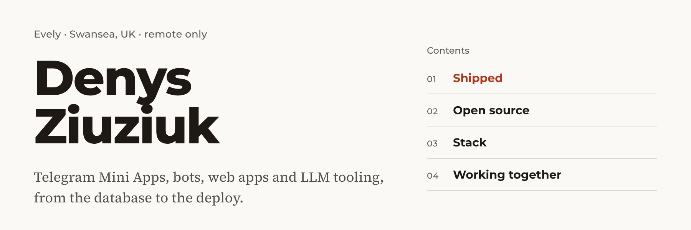
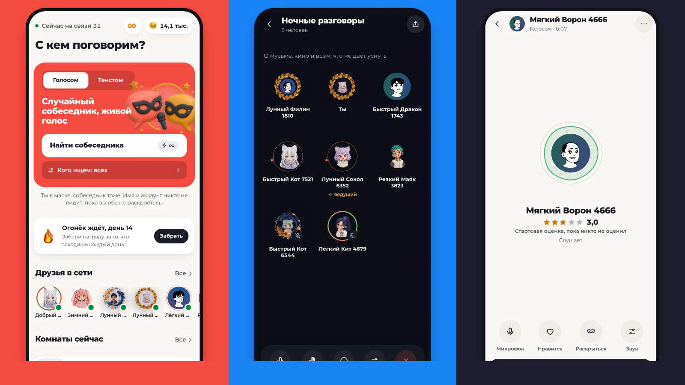
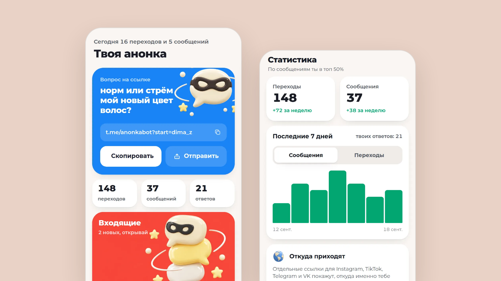
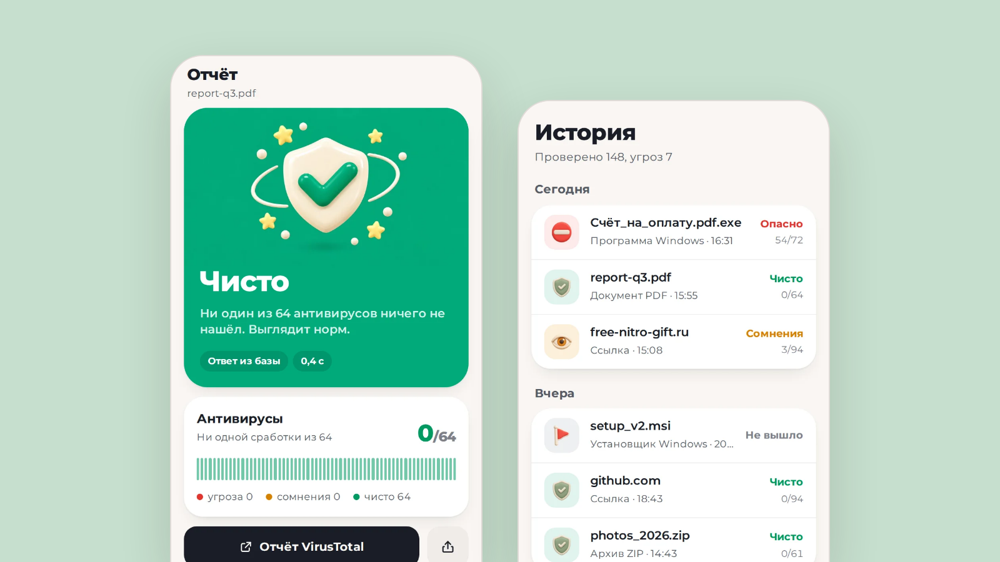
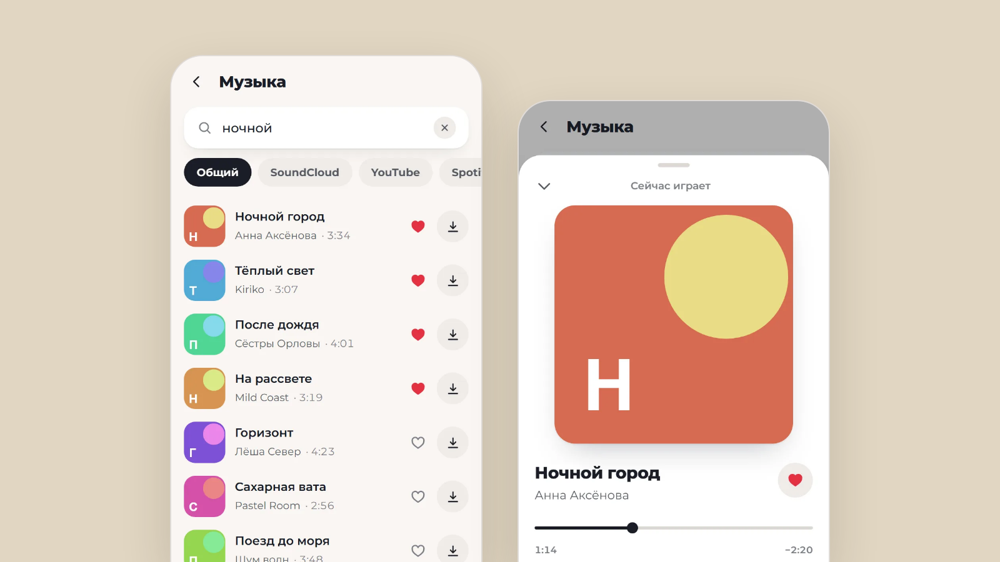

<picture>
  <source media="(prefers-color-scheme: dark)" srcset="assets/header-dark.png">
  
</picture>

I build products people open from a link and use straight away: Telegram Mini Apps with real-time voice, bots that handle payments and files, web apps, and internal tools with an LLM in the loop. One person from schema to deploy, code and access handed over at the end.

[evel.one](https://evel.one) · [LinkedIn](https://www.linkedin.com/in/denys-ziuziuk) · [Telegram](https://t.me/eveluxy) · denys.ziuziuk.w@gmail.com

## 01 · Shipped

All of these are live. Code for client and commercial work stays private, so the links go to the products themselves.

<table>
  <tr>
    <td width="50%" valign="top">
      
       <b>Anonymous voice chat</b> · Telegram Mini App
       Random matching, voice rooms for up to 8 people over WebRTC with noise suppression, five voice games, friends and streaks.
       React · TypeScript · FastAPI · PostgreSQL · Redis · WebRTC
    </td>
    <td width="50%" valign="top">
      
       <b>Anonka</b> · bot and Mini App
       Anonymous questions through a personal link, separate links per platform, a story card and weekly stats.
       Python · aiogram · FastAPI · PostgreSQL · React
    </td>
  </tr>
  <tr>
    <td width="50%" valign="top">
      
       <b>File and link checker</b> · bot and Mini App
       A verdict from 60+ antivirus engines plus ClamAV, file type, first-seen date and hashes. Works in groups, files are never stored.
       Python · aiogram · FastAPI · VirusTotal · ClamAV
    </td>
    <td width="50%" valign="top">
      
       <b>Music and video downloader</b> · Mini App
       One search across several music sources, an in-app player, and TikTok, Reels and Shorts by link. Subscriptions and an admin panel.
       Python · aiogram · FastAPI · React · TypeScript
    </td>
  </tr>
</table>

At **NetSapiens** I build internal tools for the EMEA UCaaS business, including a proposal generator that turns a pricing matrix and a short brief into a branded Word proposal: a deterministic pricing core, a docx template layer and an LLM layer for the narrative, covered by 170 tests.

## 02 · Open source

**[inkey](https://github.com/Ziuziuk-Denys/inkey)** is an offline IBus engine for Linux that fixes text typed in the wrong layout. Type `ghbdtn`, get `привет`. The Rust core sits behind a C ABI, the engine is written in C, and words are scored against frequency data at each word boundary.

## 03 · Stack

Also WebRTC, aiogram, discord.py, Tauri, Caddy and LLM APIs.

## 04 · Working together

Remote only, async, in writing. Open to contract, freelance and part-time work. Send the task, the deadline and the budget, and I reply the same day with questions or a plan and a fixed quote.
